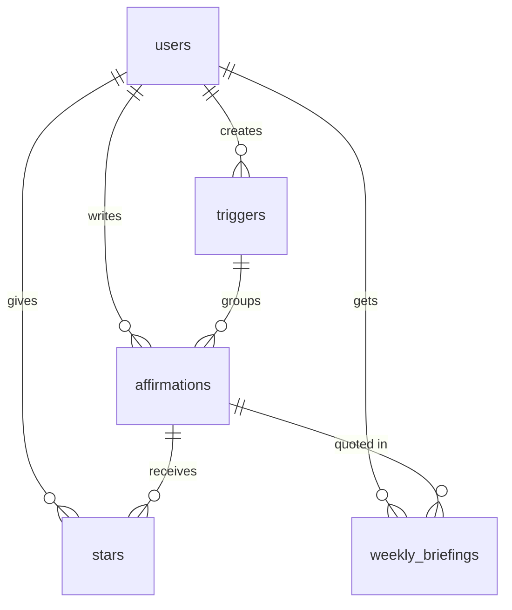

# PLAN.md — Steady

## 1. Pitch

I'm building **Steady**, an affirmations app with a weekly briefing, because I get anxiety, and two things help: knowing what's coming this week, and having the right words ready for the moments that set me off. Steady keeps my own affirmations organized by the situation they're for ("before a presentation", "can't sleep"), and once a week, on the day I pick, it pulls my week from Google Calendar, suggests what to focus on first, and pairs it with one of my affirmations.

**How often:** I'll open it most days for the affirmation of the day, reach for it in anxious moments, and read the briefing once a week.

## 2. Features

Built in this order, one PR each.

1. **Sign up and login.** As a new visitor, I want to create an account with my email and a password, then log in and log out, so that my affirmations are private to me.
2. **Moods / triggers (data model).** As a user, I want to create triggers such as "Before a presentation" or "Can't sleep", each with a name and an emoji, so that I can group affirmations by the situation they help with.
3. **Affirmations CRUD.** As a user, I want to write an affirmation (text, the trigger it's for, an optional note on why it helps), see all mine in a list, open one on its own page, edit it, and delete it after an "Are you sure?" prompt, so that my collection stays the way I want it.
4. **Validation.** As a user, if I try to save an affirmation with no text or no trigger, or a trigger with no name, I want a friendly message telling me what's missing, so that I don't save empty entries by accident.
5. **Stars.** As a user, I want to star the affirmations that work best for me and open a "Starred" view, so that my strongest ones are one tap away.
6. **Find things.** As a user, I want to search affirmations by text, filter by trigger or starred, and sort by newest, oldest, or A–Z, so that I can find the right one in an anxious moment.
7. **Dashboard.** As a user, I want a dashboard showing my total affirmations, how many I've starred, and the trigger I've written the most for, plus a bar chart of affirmations per trigger, so that I can see where I'm putting my energy.
8. **Affirmation of the day (mine).** As a user, I want the home page to show one affirmation each day, chosen at random with starred ones picked first, plus a "Give me another" button, so that I start the day with something I wrote for myself.
9. **Weekly briefing (mine).** As a user, I want to connect Google Calendar and pick my briefing day in settings, so that on that day the app shows a "Your week" page with every event from the next 7 days, grouped by day.
10. **AI prioritize + calm note (mine).** As a user, I want Claude to read my week, suggest my top 3 priorities, and write a short calm note that quotes one of my affirmations, which I can reorder, so that a busy week feels manageable.

## 3. Database

Replit's built-in PostgreSQL database. Every table except `users` has a `user_id`, and every query the server runs filters by the logged-in user's id, so each user can only read and write their own rows.

**users**

| column | type | notes |
|---|---|---|
| id | text (uuid) | **primary key** |
| email | text | required, unique |
| password_hash | text | bcrypt hash, never the real password |
| display_name | text | |
| briefing_day | number | 0 = Sunday … 6 = Saturday, default 0 |
| google_refresh_token | text | set only after connecting Google Calendar |
| created_at | date | |

**triggers**

| column | type | notes |
|---|---|---|
| id | text (uuid) | **primary key** |
| user_id | text (uuid) | → users.id |
| name | text | required, e.g. "Can't sleep" |
| emoji | text | e.g. 🌙 |
| created_at | date | |

**affirmations**

| column | type | notes |
|---|---|---|
| id | text (uuid) | **primary key** |
| user_id | text (uuid) | → users.id |
| trigger_id | text (uuid) | → triggers.id, required |
| text | text | required, max 280 characters |
| note | text | optional, "why this helps" |
| created_at | date | |
| updated_at | date | |

**stars** (junction table)

| column | type | notes |
|---|---|---|
| user_id | text (uuid) | → users.id, part of **primary key** |
| affirmation_id | text (uuid) | → affirmations.id, part of **primary key** |
| created_at | date | |

**weekly_briefings**

| column | type | notes |
|---|---|---|
| id | text (uuid) | **primary key** |
| user_id | text (uuid) | → users.id |
| week_start | date | one briefing per user per week |
| events | text (JSON) | the week's calendar events |
| priorities | text (JSON) | ordered top-3, editable |
| calm_note | text | written by Claude |
| affirmation_id | text (uuid) | → affirmations.id, the one quoted |
| created_at | date | |

**Relationships**

- users 1 → many triggers
- triggers 1 → many affirmations (each affirmation has exactly one trigger)
- users ↔ affirmations, many-to-many through **stars**
- users 1 → many weekly_briefings; each briefing quotes 1 affirmation

## 4. Tests

1. **Data isolation.** Given User A has written the affirmation "I have handled hard weeks before" and User B has a new account, when User B logs in and loads their affirmations list, then the list is empty and User A's affirmation is not returned.
2. **Dashboard stat.** Given a user has 3 affirmations under "Before a presentation" and 1 under "Can't sleep", and has starred 2 of them, when the dashboard stats are calculated, then total = 4, starred = 2, and top trigger = "Before a presentation".

## 5. Technologies

| what | choice | why |
|---|---|---|
| Coding agent | Claude Code | It works directly in my repo and can run git and the GitHub CLI for the issue → branch → PR loop. |
| Framework | Next.js (App Router, TypeScript) | One project for pages and server code, and it runs on Replit as a normal Node app. |
| Database | Replit PostgreSQL, via Drizzle ORM | Built into Replit, real relational tables; Drizzle keeps the schema in code so it's easy to compare with this plan. |
| Sign up / login | My own email + password: bcrypt-hashed passwords, login kept in an encrypted cookie (iron-session) | Any visitor can sign up inside the app without needing a Replit or Google account, and every account is a row in my `users` table. |
| Hosting | Replit Deployments | Database, secrets and hosting in one place; the Replit project is linked to my GitHub repo, and after each merge I pull `main` and redeploy. |
| Calendar | Google Calendar API (read-only), via `googleapis` | Where my week actually lives; read-only access is all the briefing needs. Connecting Google is optional and separate from login. |
| AI | Anthropic API (Claude) | Turns a list of events into a short, kind, ranked plan. |
| Charts | Recharts | Simple React charts for the dashboard. |
| Styling | Tailwind CSS | Fast to build a consistent soft look. |
| Tests | Vitest | Fast, simple test runner that works with TypeScript. |

## 6. Design

Soft and calm. Muted sage green as the main color, lavender for accents, warm off-white background, rounded cards with lots of whitespace, a gentle rounded sans-serif font. Nothing red or alarming: error messages are soft amber and worded kindly ("Add a few words first"). Inspiration: **Calm** (quiet color, one thing per screen) and **Headspace** (friendly, rounded, encouraging).

## 7. Risks and cuts

- **Least sure I can build:** the Google Calendar connection. Google shows an "unverified app" warning, and only accounts I add as test users can connect, so a stranger may not be able to use the briefing.
- **Deploys are manual:** Replit doesn't redeploy on every merge the way Vercel would, so the live URL can fall behind `main`. I'll redeploy after every merged PR.
- **Cut first:** AI prioritization (feature 10). If time runs short, the briefing shows my week without Claude's ranking, and I swap in a simpler third feature (anxiety check-in).
- **Also cut if needed:** the user-picked briefing day becomes fixed to Sunday.
- **Not doing now:** Gmail. Reading email is planned for the team project, which is about connecting outside APIs.
