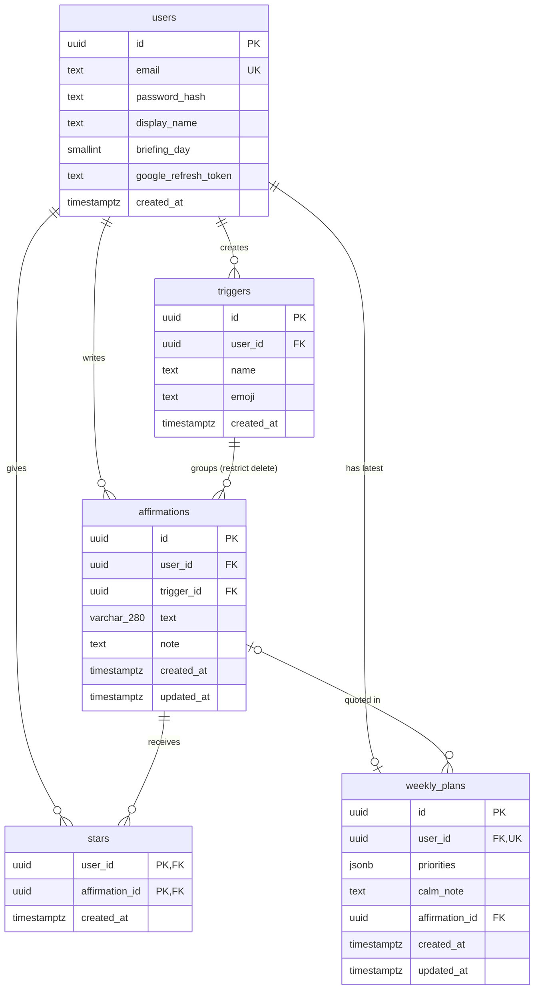

# Database schema

Steady stores its data in **Postgres** (Supabase in production, PGlite locally). The schema is defined in code in [`src/db/schema.ts`](src/db/schema.ts) with Drizzle ORM. Each change is a numbered SQL migration in [`drizzle/`](drizzle/), applied automatically on every Vercel deploy.

**Privacy rule:** every table except `users` has a `user_id`, and every query the server runs filters by the logged-in user's id. Users can only read and change their own rows. The automated test `tests/data-isolation.test.ts` checks this.

## Diagram

## Tables

### `users`: one row per account
Migration `0000_create_users.sql`

| column | type | rules | notes |
|---|---|---|---|
| `id` | uuid | **primary key**, random default | |
| `email` | text | required, **unique** | |
| `password_hash` | text | required | bcrypt hash; the real password is never stored |
| `display_name` | text | optional | |
| `briefing_day` | smallint | required, default `0` | 0 = Sunday … 6 = Saturday; set in Settings |
| `google_refresh_token` | text | optional | set only after connecting Google Calendar; **encrypted** (AES-256-GCM) before saving |
| `created_at` | timestamptz | required, default now | |

### `triggers`: the moods or situations affirmations are grouped by
Migration `0001_create_triggers.sql`

| column | type | rules | notes |
|---|---|---|---|
| `id` | uuid | **primary key** | |
| `user_id` | uuid | required, → `users.id` (delete cascades) | owner |
| `name` | text | required | e.g. "Can't sleep"; up to 40 characters, no duplicates per user (case-insensitive), checked in `src/lib/validation.ts` |
| `emoji` | text | required, default 🌿 | e.g. 🌙 |
| `created_at` | timestamptz | required, default now | |

### `affirmations`: what the user wrote to read in a hard moment
Migration `0002_create_affirmations.sql`

| column | type | rules | notes |
|---|---|---|---|
| `id` | uuid | **primary key** | |
| `user_id` | uuid | required, → `users.id` (delete cascades) | owner |
| `trigger_id` | uuid | required, → `triggers.id` (**delete restricted**) | a trigger can't be deleted while affirmations use it |
| `text` | varchar(280) | required | max 280 characters, enforced by the database and by validation |
| `note` | text | optional | "why this helps", up to 500 characters |
| `created_at` | timestamptz | required, default now | |
| `updated_at` | timestamptz | required, default now | set again on every edit |

### `stars`: junction table (users ↔ affirmations, many-to-many)
Migration `0003_create_stars.sql`

| column | type | rules | notes |
|---|---|---|---|
| `user_id` | uuid | **primary key (part 1)**, → `users.id` (delete cascades) | who starred |
| `affirmation_id` | uuid | **primary key (part 2)**, → `affirmations.id` (delete cascades) | what was starred |
| `created_at` | timestamptz | required, default now | |

The pair `(user_id, affirmation_id)` is the primary key, so the same affirmation can't be starred twice.

### `weekly_plans`: Claude's top 3 priorities and calm note for the user's week
Migration `0004_create_weekly_plans.sql`

| column | type | rules | notes |
|---|---|---|---|
| `id` | uuid | **primary key** | |
| `user_id` | uuid | required, **unique**, → `users.id` (delete cascades) | one saved plan per user; "Try again" replaces it |
| `priorities` | jsonb | required | exactly 3 `{ title, why }` items, in the user's chosen order |
| `calm_note` | text | required | written by Claude |
| `affirmation_id` | uuid | optional, → `affirmations.id` (delete **sets null**) | the affirmation shown under the note; always one of the user's own |
| `created_at` | timestamptz | required, default now | when the plan was made |
| `updated_at` | timestamptz | required, default now | last reorder |

## Relationships

- **users 1 → many triggers**
- **users 1 → many affirmations**
- **triggers 1 → many affirmations.** Each affirmation has exactly one trigger.
- **users ↔ affirmations, many-to-many through `stars`**
- **users 1 → 0 or 1 weekly_plans**, which quotes 0 or 1 affirmation

## What happens on delete

| when you delete… | what happens |
|---|---|
| a user | their triggers, affirmations, stars and plan are all deleted (cascade) |
| a trigger | **refused** while any affirmation still uses it; the app only offers Delete when its count is 0 |
| an affirmation | its stars are deleted; a plan quoting it keeps the plan but loses the quote (set null) |

## Not stored in the database

- **Calendar events** are fetched from Google each time Your week opens and are never saved.
- **Affirmation of the day** is computed from the user id and today's date, so there's nothing to store.
- **Login sessions** live in an encrypted cookie (iron-session), not in a table.
